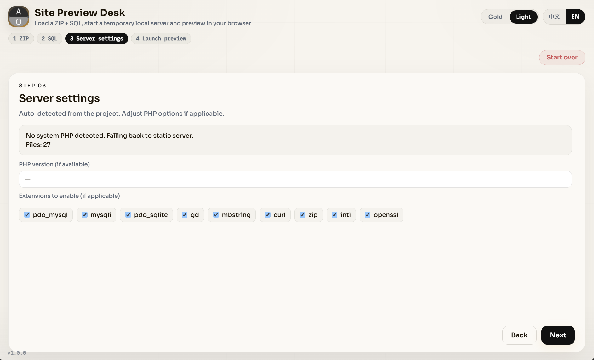

<div align="center">

# 本地站点预览器

**由安溯媒体打包**

加载网站 ZIP 与可选 SQL，在软件内全屏预览临时本地站点。

<p>
  <a href="../README.md"></a>
</p>

<p>
  <a href="#install">安装</a> ·
  <a href="#features">功能</a> ·
  <a href="#requirements">环境</a> ·
  <a href="#architecture">结构</a> ·
  <a href="#documentation">常见问题</a>
</p>

<p>
  
  
  
  
</p>

</div>

<div align="center">
  
</div>

> [!NOTE]
> 未签名的 EXE 可能触发 Windows SmartScreen，属正常现象。

---

## 一览

| | |
|---|---|
| 做什么 | 加载站点 ZIP（可选 SQL），用临时本地服务器预览 |
| 在哪看 | 软件内全屏弹窗 |
| 技术 | FastAPI + 静态界面 + pywebview + PyInstaller |
| 主题 | 黑金默认，可切浅色 |
| 语言 | 中文 / EN |

<a id="install"></a>

## 安装

### 1. GitHub Deploy Desk（推荐）

用 [GitHub Deploy Desk](https://github.com/axioxmedia/github-deployer) 一键部署本仓库。

1. 获取部署器：https://github.com/axioxmedia/github-deployer
2. 把本仓库 URL 粘进 Deploy Desk。
3. 在应用内阅读 README，确认后再部署。

这是支持的安装路径。只有在本地已检出源码时，才用下面的源码 / EXE 步骤。

### 2. 源码运行或打包 EXE

```bat
python -m venv .venv
.venv\Scripts\activate
pip install -r requirements.txt
python app.py
```

打包：

```bat
build_exe.bat
```

生成物：`dist\SitePreviewDesk.exe`。详见 `HOW_TO_BUILD.txt`。

<a id="features"></a>

## 功能

| 功能 | 说明 |
|---|---|
| 文件对话框 | ZIP 与 SQL 均用系统文件管理器，不用手输路径。 |
| SQL 可选 | 不选 SQL 也能下一步。 |
| 检测 | PHP 是否存在、版本、常用扩展。 |
| 预览 | 解压 ZIP，尽可能把 SQL 导入临时 SQLite，优先 `php -S`，否则纯 Python 静态服务。 |
| 软件内查看 | 全屏弹窗，不会再开一个本软件窗口。 |
| 重新开始 | 从第二步起可清空选择并回到第一步。 |
| 主题 / 语言 | 黑金与浅色。中文 / EN。会话记忆开启。 |

<a id="requirements"></a>

## 环境

| | 最低 | 建议 |
|---|---|---|
| 系统 | Windows 10 | Windows 11 |
| Python | 3.11（打包用） | 3.11+ |
| PHP | 可选 | ZIP 含 `.php` 时建议在 PATH 中 |

<a id="architecture"></a>

## 结构

```
pywebview 窗口
    └── FastAPI (127.0.0.1)
            ├── static/  步骤向导
            └── /api/*   选择、检测、启动、停止
                    └── 临时解压目录
                            ├── php -S          （有 PHP 且含 .php）
                            └── http.server     （打包后安全的静态回退）
                                    └── 软件内 iframe 全屏
```

<a id="documentation"></a>

## 常见问题

<details>
<summary>预览是空白。</summary>

确认 ZIP 根目录（或 `public/`）有 `index.html` 或 `index.php`。PHP 页面需要系统 PATH 里有 `php`。
</details>

<details>
<summary>SmartScreen 拦截 EXE。</summary>

程序未签名。选「更多信息」→「仍要运行」，或用 `build_exe.bat` 自己打包。
</details>

---

由安溯媒体打包 · [axiox.media](https://axiox.media)
